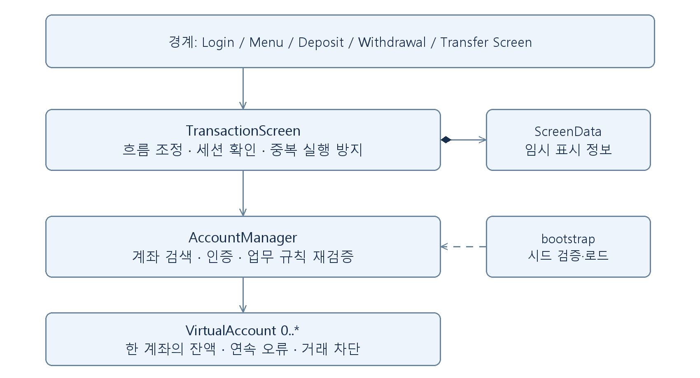

# ATM 제어 및 관리 시스템

[](https://github.com/Ryoqon-dev/ATM-/actions/workflows/tests.yml)


가상 계좌로 로그인, 잔액 조회, 입금, 출금, 이체를 경험하는 소프트웨어공학 개인 프로젝트입니다. Python 3.13과 Tkinter로 구현했으며 제품 실행에는 외부 패키지가 필요하지 않습니다.

**앱 v1.0.0 구현 완료 · 자동 시험 68개 통과 · 설계 시험 사례 37개 연결**

[빠른 시작](#바로-실행하기) · [기능](#주요-기능) · [구조](#프로젝트-구조) · [시험](#시험-실행) · [문서](#문서-바로-보기)

## 바로 실행하기

Windows에 Python 3.13 이상이 설치되어 있다면, 저장소를 복제하고 바로 실행할 수 있습니다.

```powershell
git clone https://github.com/Ryoqon-dev/ATM-.git
cd ATM-
python run_atm.py
```

Windows에서는 `ATM_실행.pyw`를 더블클릭해도 됩니다. 두 실행 파일은 `src`의 앱을 불러오므로 별도 설치 없이 사용할 수 있습니다.

| 체험 계좌 | 계좌번호 | 가상 PIN | 초기 잔액 |
| --- | --- | --- | --- |
| A | `100100000001` | `0123` | 500,000원 |
| B | `100100000002` | `5678` | 2,000,000원 |
| C | `100100000003` | `0000` | 0원 |

로그아웃해도 실행 중 잔액과 차단 상태는 유지됩니다. **앱을 재시작하면 시드 초기 상태로 돌아갑니다.**

### 처음 실행했다면

계좌 A로 로그인한 다음 아래 거래를 순서대로 진행해 보세요.

| 순서 | 동작 | 확인할 결과 |
| --- | --- | --- |
| 1 | 계좌 A로 로그인 | 잔액 500,000원 |
| 2 | 30,000원 입금 | 잔액 530,000원 |
| 3 | 계속 이용 → 20,000원 출금 | 잔액 510,000원, 명세표 안내 |
| 4 | 명세표 선택 → `999999999999`로 10,000원 가상 이체 | 잔액 500,000원 |
| 5 | 거래 종료 | 입력값을 지우고 로그인 화면으로 복귀 |

## 주요 기능

| 기능 | 규칙 |
| --- | --- |
| 로그인 | 계좌번호 숫자 12자리, PIN 숫자 4자리. 연속 5회 PIN 불일치 시 계좌 차단 |
| 잔액 조회 | 로그인 직후와 거래 성공 후 최신 잔액 표시 |
| 입금 | 양의 정수, 1회 최대 100만 원 |
| 출금 | 1만 원 단위, 1회 최대 100만 원, 실제 잔액 이내 |
| 가상 이체 | 본인과 다른 12자리 대상 번호, 잔액 이내, 송신 계좌에서만 차감 |
| 거래 종료 | 숨겨진 입력값과 세션 표시 정보를 지우고 로그인으로 복귀 |

형식 오류와 미등록 계좌 입력은 PIN 오류 횟수를 늘리지 않습니다. 미차단 계좌의 정상 로그인은 연속 오류 횟수를 초기화합니다. 명세표는 화면 안내만 제공하며 실제 은행 연동·현금 처리·수신 계좌 입금·인쇄는 포함하지 않습니다.

## 프로젝트 구조

```text
ATM-/
├─ .github/workflows/           # GitHub Actions 자동 시험
├─ src/atm_app/                 # 제품 코드
│  ├─ __main__.py               # 초기화와 계층 조립
│  ├─ domain/                   # 계좌 객체, 금액·입력 규칙
│  ├─ application/              # 계좌 서비스, 세션 자료
│  ├─ presentation/             # Tkinter 화면, 거래 흐름 제어
│  ├─ infrastructure/           # JSON 시드 로딩과 초기 데이터
│  └─ shared/                   # 공통 오류와 결과 코드
├─ tests/                       # 단위·GUI 통합·구조 회귀 시험
├─ docs/                        # Word 가이드, 설계·개발·시험 문서
│  ├─ design/                   # 기존 HWPX·PDF·설계서·피드백
│  ├─ development/              # 인터페이스·데이터·시험 계획
│  ├─ results/                  # 실제 실행 결과와 구현 현황
│  └─ diagrams/                 # UML 이미지·SVG·PlantUML
├─ models/visual-paradigm/      # 기존 VPP 모델
├─ tools/                       # 시험·계약 검사 도구
│  └─ docs/                     # 문서 생성·검증 도구
├─ run_atm.py                   # 설치 없는 명령행 실행
├─ ATM_실행.pyw                 # Windows 더블클릭 실행
├─ pyproject.toml               # src 패키지와 실행 명령 설정
└─ .gitignore                   # 가상환경·임시 자료·백업 제외
```

기존 `ATM_system`은 `models/visual-paradigm`으로 옮겼습니다. 기존 원본 백업과 검토 이미지는 `.artifacts`에 보존했으며 Git 추적에서 제외합니다.

### 시스템 구조



## 계층별 책임

| 계층 | 핵심 코드 | 책임 |
| --- | --- | --- |
| domain | `virtual_account.py`, `validation.py` | 잔액·오류 횟수·차단 불변식과 거래 검증 |
| application | `account_manager.py`, `screen_data.py` | 인증·거래 서비스와 현재 세션 정보 |
| presentation | 화면 5개, `transaction_screen.py` | 입력·결과 표시, 화면 전환, 인증 세션과 중복 실행 방지 |
| infrastructure | `bootstrap.py`, `data/` | 초기 JSON 전체 검증과 가상 계좌 구성 |
| shared | `errors.py` | 계층 간 공통 오류·안내 코드 |

`__main__.py`가 시드와 서비스를 만든 뒤 GUI에 주입합니다. 도메인과 서비스는 Tkinter에 의존하지 않습니다. 화면의 표시 잔액은 사본이며, 거래 승인은 실제 계좌 잔액으로 판단합니다.

## 시험 실행

```powershell
python run_atm.py --check
python -X utf8 tools/run_tests.py
python -X utf8 tools/verify_implementation.py
```

- `--check`: 창을 열지 않고 초기 계좌 자료를 검사합니다.
- `run_tests.py`: 전체 시험을 실행하고 `docs/results/테스트결과.md`와 JSON을 갱신합니다.
- `verify_implementation.py`: 설계 메소드 44개와 문서·데이터 연결을 검사합니다.

GUI 시험에는 화면을 사용할 수 있는 Tk 환경이 필요합니다. `Enter`로 로그인·거래 확인, `Esc`로 입력 취소를 할 수 있습니다. 출금 결과에서는 명세표 예·아니오를 선택한 뒤 계속 이용하거나 종료합니다.

GitHub Actions는 `main`에 푸시하거나 Pull Request를 열 때 Windows와 Python 3.13에서 동일한 시험을 실행합니다. 실행 상태는 상단 Tests 배지와 [Actions](https://github.com/Ryoqon-dev/ATM-/actions)에서 확인할 수 있습니다.

## 가상환경과 패키지 설치

소스를 직접 실행할 때는 설치가 필요하지 않습니다. 패키지 방식으로 개발하려면 다음을 사용합니다.

```powershell
python -m venv .venv
.\.venv\Scripts\python.exe -m pip install -e .
.\.venv\Scripts\python.exe -m atm_app
```

`python -m atm_app`은 `src` 구조이므로 패키지를 설치한 환경에서 사용합니다. 설치 전에는 `python run_atm.py`로 실행하세요. 설치 과정의 빌드 도구는 제품 실행 의존성과 별개입니다.

## 문서 바로 보기

| 자료 | 내용 |
| --- | --- |
| [Word 프로젝트 가이드](docs/ATM_프로젝트_구조및개발가이드.docx) | 프로젝트 구조, 계층, 실행·시험, 메소드와 시험 사례, GitHub 정리 기준 |
| [문서 안내](docs/README.md) | 현재 문서와 기존 설계 자료의 읽는 순서 |
| [설계서 본문](docs/design/상세설계서_최종보완_원문.md) | 피드백을 반영한 상세설계 원문 |
| [기존 검토용 PDF](docs/design/ATM_상세설계서_최종보완_검토용.pdf) | 설계 기준 v3.0.0의 39쪽 검토본 |
| [개발 준비 자료](docs/development/README.md) | 인터페이스·데이터·시험 계획 |
| [현재 구현 현황](docs/results/구현현황.md) | 클래스·메소드와 실제 코드 연결 |
| [자동 시험 결과](docs/results/테스트결과.md) | 실제 시험 실행 기록과 설계 TC별 근거 |
| [구조 정리 기록](docs/results/구조정리_검증.md) | 이동 내역, 실행 경로, 패키징과 원본 보존 검증 |

기존 설계서는 작성 당시의 기능·설계 기준으로 보존합니다. 현재 위치와 실행 방법은 이 README와 Word 가이드를 따릅니다. 문서 생성 도구의 외부 패키지는 `tools/docs/requirements.txt`에 분리되어 있습니다.

## GitHub에 포함할 자료

`src`, `tests`, `docs`, `models`, `tools`, 실행 파일과 프로젝트 설정을 함께 관리합니다. `.venv`, `.artifacts`, 빌드 결과, Python 캐시와 VPP 자동 백업은 `.gitignore`로 제외합니다. 원래 모델과 설계 자료를 보존하면서 실행 코드와 현재 검증 결과를 함께 확인할 수 있게 구성했습니다.

검증 환경은 Windows, Python 3.13, Tk 8.6입니다. 실제 Tk 위젯·이벤트 처리·최소 창 크기의 주요 입력과 버튼 배치를 자동 시험으로 확인했습니다. 다른 운영체제의 동작은 별도로 검증하지 않았습니다.
