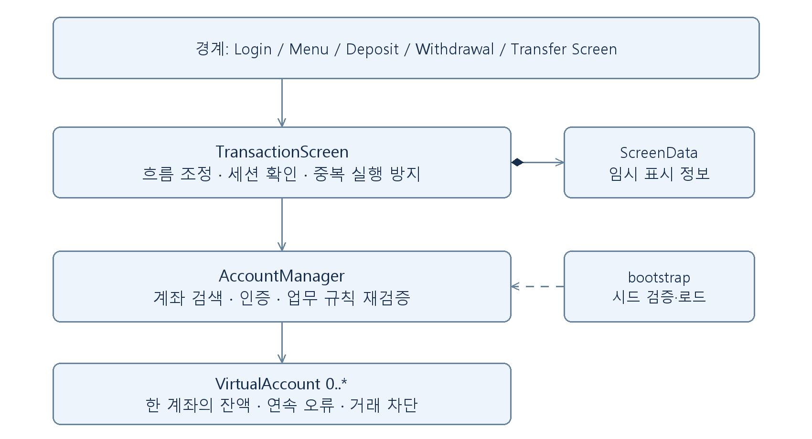
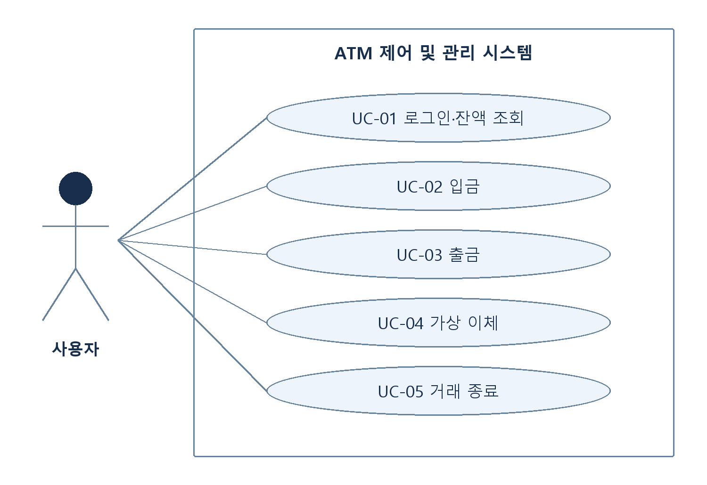
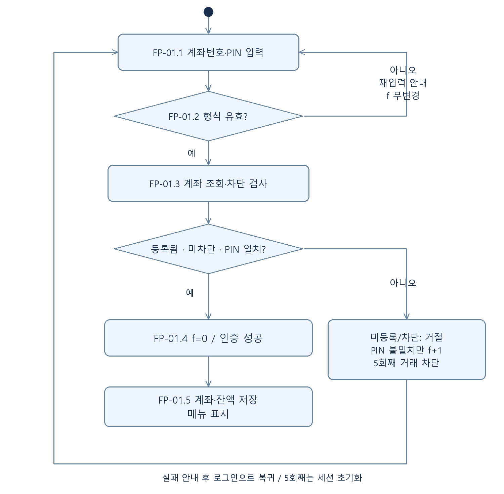
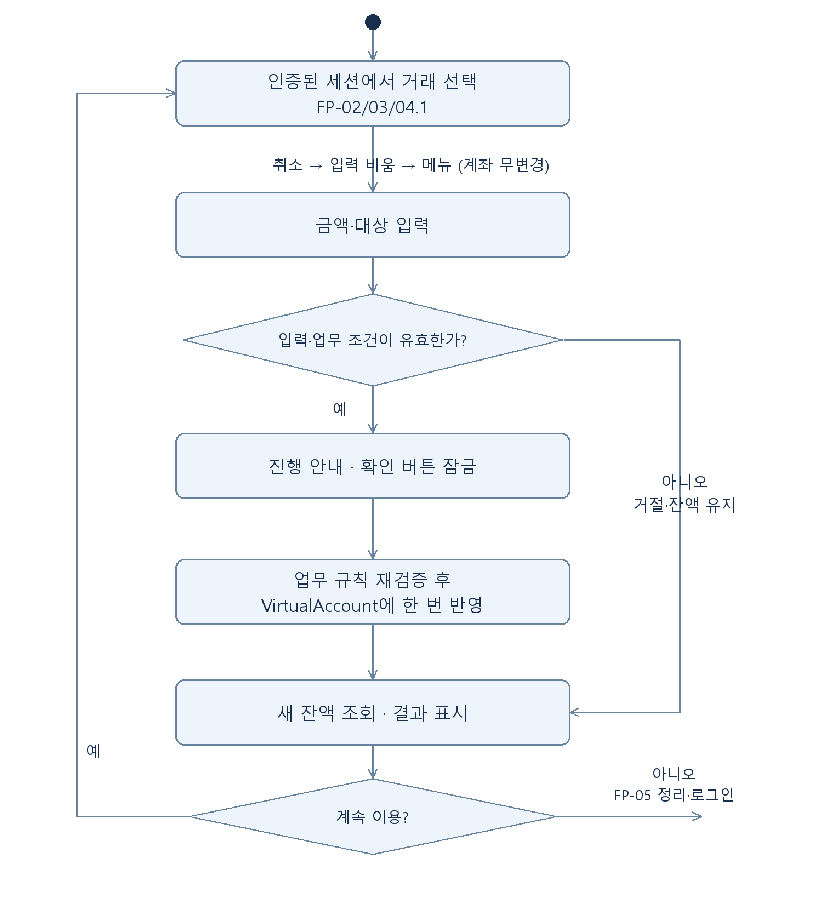
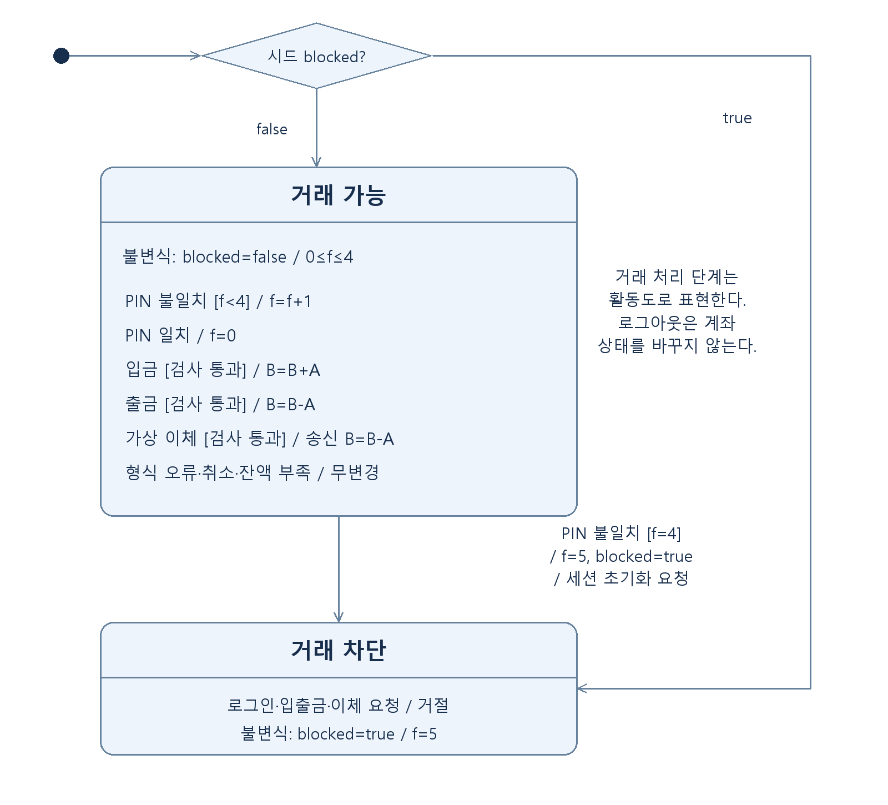
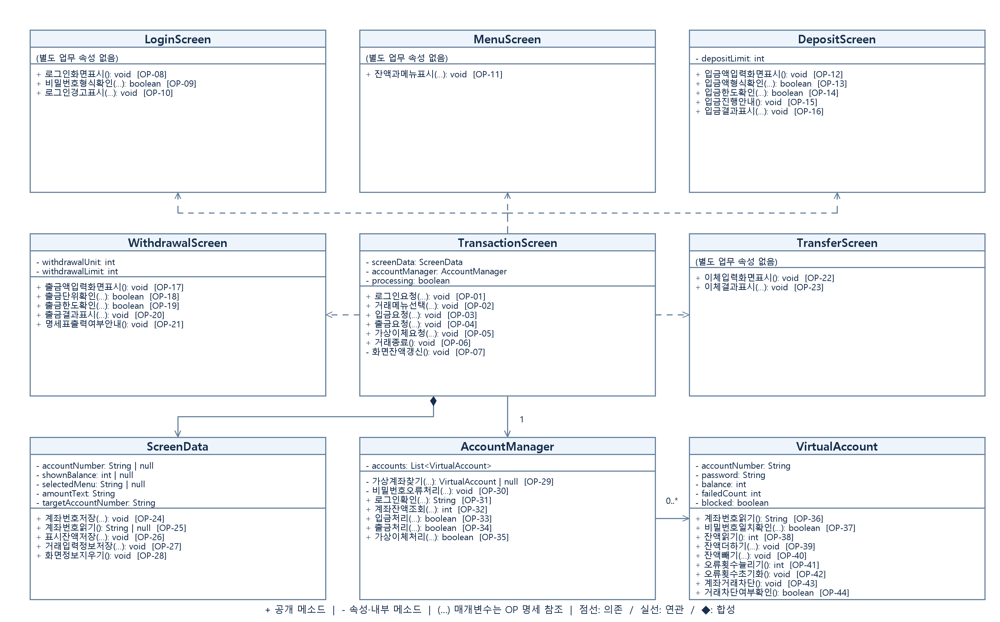
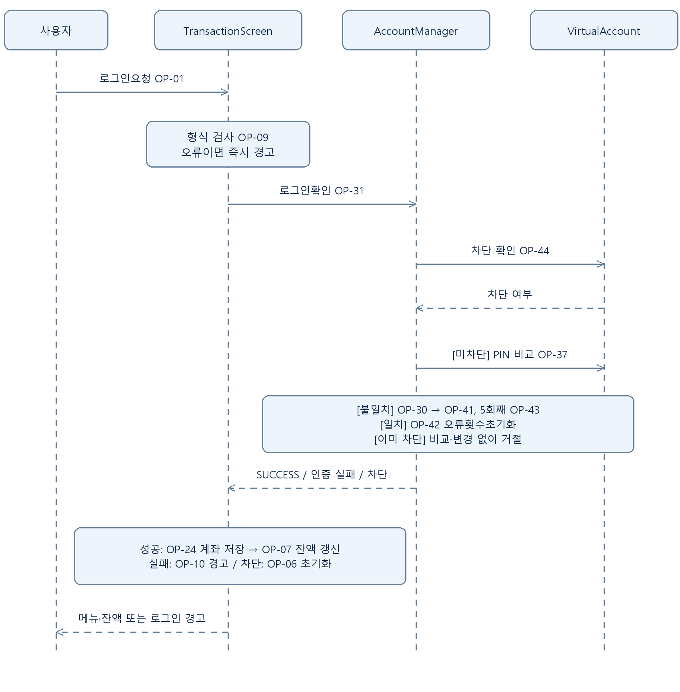
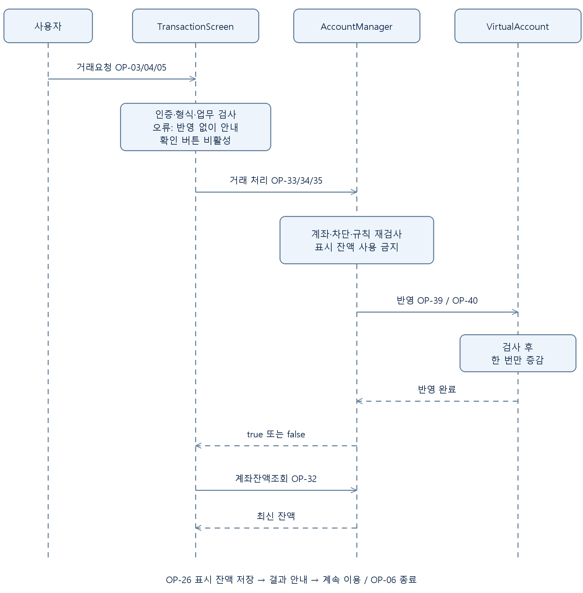

# 표지
문서 구성 쪽 1

## 2026년 2학기 SW공학

## 소프트웨어공학 상세설계서

ATM 제어 및 관리 시스템 개발

11월 16일 교수님 피드백 반영 최종 보완본

컴퓨터공학부 | 2023243047 | 박교범

개정일 2026. 11. 18. | 통합 버전 v3.0.0

가상 계좌를 이용한 로컬 ATM 학습 시뮬레이터

요구사항 → 기능 프로세스 → 유즈케이스 → 메소드 → UML → 검증의 연결을 기준으로 작성하였다.

# 문서 관리 및 피드백 반영
문서 구성 쪽 2

요구사항 정의서와 상세설계서를 통합한 기준 문서이다. 원문의 작성자·학번과 핵심 기능 범위를 보존하고, 2026-11-16 피드백 및 개발 착수에 필요한 미정 규칙을 보완하였다. 교수자의 확인 또는 승인을 받았다는 의미는 아니다.

| 일자 | 버전 / 내용 |
| --- | --- |
| 2026-10-19~11-02 | 요구사항 v1~v3: 원문에 기록된 이력 |
| 2026-11-09 | 상세설계 v1: 최초 등록 |
| 2026-11-13 | 상세설계 v2: 원문 최종본 |
| 2026-11-18 | 통합 v3: 11/16 피드백 반영 및 개발 준비 문서 추가 |

| 피드백 | 반영 내용 |
| --- | --- |
| FB-01 요구사항을 문장으로 작성 | 모든 REQ를 주어·조건·동작·예외를 갖춘 규범 문장으로 작성하였다. |
| FB-02 상태도의 개념 객체 재선정 | VirtualAccount 한 개를 상태도 대상으로 정하고 계좌 생명주기와 작업 흐름을 구분하였다. |
| FB-03 워크플로우 도출 근거 | REQ→UC→FP 단계→OP 연결을 명시하고 기능 프로세스를 먼저 서술하였다. |
| FB-04 클래스 그림 대칭 | 동일 폭과 일정 간격의 3열 UML을 새로 작성하고 상세도를 별도 제공하였다. |
| FB-05 메소드의 앞선 명세 | 44개 메소드에 OP ID, 입출력, 행위, FP·REQ 근거를 부여하고 클래스 그림 앞에 배치하였다. |

추가 교정: NoteMaestro/Midi Engine 예시를 ATM 구조로 대체하였다. REQ-LOGIN-3, UDC-01-02 등 ID 오기와 출금 안내의 요구사항 연결 오류를 정리하였다. 외부 은행은 실제 연동 대상이 아니므로 액터에서 제외하였다.

# 문서 구성과 읽는 순서
문서 구성 쪽 3

본 문서는 요구사항 정의, 요구 모델링, 기능 및 메소드 명세, 개념 및 클래스 모델링, 데이터·화면 설계, 검증과 개발 계획의 순서로 구성한다.

| 구성 | 내용 |
| --- | --- |
| I. 요구사항 정의 | 범위, 원래 요구사항 15개, 보완 규칙 D-01~07, 품질 요구사항 REQ-Q-01~05 |
| II. 요구 모델링 | 유즈케이스, FP-01~05 기능 프로세스, 활동도, CRUD |
| III. 기능·메소드 명세 | 클래스 그림 이전에 9개 클래스의 44개 메소드와 속성을 정의 |
| IV. 개념 및 설계 모델 | 개념 객체 선정, 단일 계좌 상태도, 클래스도, 로그인·거래 시퀀스 |
| V. 구현 준비와 검증 | 자료 구조, 화면 이동, 오류 처리, 추적표, 시험 계획, 개발 순서 |

## 식별자 규칙

REQ는 요구사항, UC는 사용자 목표, FP는 기능 프로세스와 단계, OP는 클래스 메소드, TC는 시험 사례, D는 설계 결정을 나타낸다. 예: REQ-BANK-08 → UC-03 → FP-03.4 → OP-04/34/40 → TC-W04.

기존 세부 UC-01-01 등은 독립된 사용자 목표보다 내부 처리 단계에 가까우므로 FP 하위 단계로 통합하였다. 모든 주요 기능은 UC-01~05로 유지한다. 명세서와 UML, 개발 준비 문서는 동일한 식별자를 사용한다.

## 함께 제공하는 개발 준비 자료

개발준비/README.md에서 개발환경, 인터페이스 계약, 데이터 스키마·시드, 시험 사례, 구현 순서, 설계 결정 및 피드백 추적표를 찾아볼 수 있다. 다이어그램/최종보완에는 수정 가능한 SVG·PlantUML과 문서 삽입용 PNG를 제공한다.

# I-1. 시스템 개요와 범위
문서 구성 쪽 4

본 프로젝트는 ATM의 로그인, 잔액 조회, 입금, 출금, 가상 이체, 거래 종료를 GUI로 구현하는 개인 프로젝트이다. 미리 준비한 가상 계좌를 사용하여 입력 검증, 상태 변화, 예외 처리 및 객체 간 책임 분리를 학습한다.

| 구분 | 처리 범위 |
| --- | --- |
| 포함 | 가상 계좌 인증, 연속 PIN 오류 5회 차단, 즉시 잔액 표시, 1회 100만 원 이하 입금·출금, 1만 원 단위 출금, 송신 계좌 차감 방식의 가상 이체, 세션 정리 |
| 제외 | 실제 은행 서버·타행 송금·증권·해외 송금, 실물 카드·지폐·프린터, 계좌 개설·삭제, 관리자 차단 해제 UI, 수수료·일일 한도·다중 사용자 동시 접속 |
| 개발 기준안 | Python/Tkinter 데스크톱 앱, 실행 중 메모리 계좌 목록, JSON 시드 입력, 표준 unittest 사용 |
| 자료 유지 | 로그아웃은 화면만 정리한다. 계좌 자료는 앱 실행 동안 유지하고 재시작 시 시드로 복구한다. |

이체는 실제 자금 이동을 구현하지 않는다. 대상 계좌번호는 일반 은행 계좌를 가정한 가상 식별자이고, 송신 계좌에서만 금액을 차감한다. 로컬의 다른 시드 계좌를 대상으로 입력해도 그 계좌 잔액을 증가시키지 않는다.

이 문서의 D-01~07 및 REQ-Q 항목은 교수님 피드백의 직접 지시가 아니라 원문에 정의되지 않은 경계 동작을 개발 가능하게 만든 보완 설계이다. 기능 확대가 필요한 경우 변경관리 문서에 영향 범위를 기록한다.

# I-2. 인증·시스템 요구사항
문서 구성 쪽 5

## REQ-LOGIN-01

시스템은 초기 화면에서 가상 계좌번호와 비밀번호를 입력받고, 등록된 계좌의 인증에 성공한 사용자에게만 거래 메뉴를 제공해야 한다.

## REQ-LOGIN-02

시스템은 비밀번호를 ASCII 숫자 4자리의 문자열로 검사해야 하며, 빈 문자열·문자·길이 오류가 있으면 비밀번호를 비교하지 않고 재입력을 안내해야 한다.

## REQ-LOGIN-03

시스템은 등록된 미차단 계좌의 비밀번호가 불일치할 때마다 연속 오류 횟수를 1회 증가시키고, 5회째에는 해당 계좌의 거래를 차단하고 임시 화면 정보를 지운 뒤 초기 로그인 화면을 표시해야 한다.

## REQ-SYS-01

시스템은 사용자가 종료를 선택하거나 거래 후 계속 이용하지 않겠다고 선택하면 계좌번호·잔액·거래 입력값·비밀번호 입력란 등 세션 정보를 지우고 초기 로그인 화면을 표시해야 한다.

## 인증 규칙 보충

계좌번호와 PIN의 앞자리 0은 보존한다. 형식 오류와 미등록 계좌는 특정 계좌의 오류 횟수를 바꾸지 않는다. 1~4회 불일치 후 정상 PIN을 입력하면 횟수는 0으로 초기화된다. 차단 후에는 같은 PIN이 맞아도 인증할 수 없다. 차단 해제는 앱 재시작 시 시드 초기화로만 가능하다.

# I-3. 입금·출금 요구사항
문서 구성 쪽 6

## REQ-BANK-01

시스템은 로그인 성공 직후 현재 가상 계좌의 잔액을 거래 메뉴 화면에 표시하고, 거래 성공 후에도 변경된 잔액으로 화면을 갱신해야 한다.

## REQ-BANK-02

시스템은 입금액을 ASCII 숫자로 구성된 양의 정수로 검사하고, 빈 값·0·음수·소수·공백·문자가 포함된 입력이면 이유를 안내하고 해당 입금을 취소해야 한다.

## REQ-BANK-03

시스템은 1회 입금액을 1,000,000원 이하로 제한하고, 이를 초과하면 잔액을 변경하지 않고 한도 초과를 안내해야 한다.

## REQ-BANK-04

시스템은 입금 조건을 모두 통과하면 “입금 중입니다.”를 표시하고, 입금액을 해당 계좌 잔액에 한 번만 더한 뒤 완료 결과와 새 잔액을 표시해야 한다.

## REQ-BANK-05

시스템은 출금액을 0보다 큰 10,000원의 배수로 제한하고, 입력 형식 또는 단위가 맞지 않으면 출금을 취소하고 오류를 안내해야 한다.

## REQ-BANK-06

시스템은 1회 출금액을 1,000,000원 이하로 제한하고, 이를 초과하면 잔액을 변경하지 않고 한도 초과를 안내해야 한다.

## REQ-BANK-07

시스템은 출금 직전에 현재 계좌의 실제 잔액을 확인하고, 출금액이 잔액보다 크면 “잔액이 부족합니다.”를 표시하고 출금을 취소해야 한다.

## REQ-BANK-08

시스템은 출금 조건을 모두 통과하면 계좌 잔액에서 출금액을 한 번만 차감하고, 새 잔액과 출금 완료 결과 및 명세표 출력 여부 안내를 표시해야 한다.

# I-4. 이체 및 품질 요구사항
문서 구성 쪽 7

## REQ-BANK-09

시스템은 가상 이체 대상 계좌번호와 양의 정수 송금액을 입력받고, 대상 계좌번호가 설계 형식에 맞지 않거나 본인 계좌이면 이체를 취소하고 오류를 안내해야 한다.

## REQ-BANK-10

시스템은 가상 이체 직전에 송신 계좌의 실제 잔액을 확인하고, 송금액이 잔액보다 크면 잔액 부족을 안내하고 이체를 취소해야 한다.

## REQ-BANK-11

시스템은 가상 이체 조건을 모두 통과하면 송신 가상 계좌의 잔액에서 송금액을 한 번만 차감하고, “이체가 완료되었습니다.”와 새 잔액을 표시해야 한다.

## 보완 품질 요구사항

REQ-Q-01 시스템은 인증된 세션이 없거나 계좌가 차단된 상태에서 거래 제어기에 입금·출금·이체 요청이 들어오면 요청을 거절하고 잔액을 유지해야 한다.

REQ-Q-02 시스템은 거래 처리 중 같은 확인 동작이 중복 실행되지 않게 하고, 승인된 거래 한 건당 잔액을 한 번만 변경해야 한다.

REQ-Q-03 시스템은 업무 오류나 예상하지 못한 예외가 발생하면 성공 문구를 표시하지 않고, 승인되지 않은 거래의 잔액을 유지해야 한다.

REQ-Q-04 시스템은 로그인 화면에서 PIN을 마스킹하고 PIN을 ScreenData나 로그에 보관하지 않아야 한다. 실계좌·실비밀번호를 사용하지 않는다.

REQ-Q-05 시스템은 잘못된 초기 데이터의 중복 계좌번호·음수 잔액·오류 횟수/차단 불일치를 발견하면 거래 화면을 제공하지 않고 데이터 오류를 안내해야 한다.

계좌 잔액은 정수 원 단위로 처리한다. Python에서 bool은 int의 하위 유형이므로 서비스의 금액 검사에서는 type(amount) is int인 경우만 허용한다.

# I-5. 미정 규칙의 설계 결정
문서 구성 쪽 8

## D-01 구현 기준

Python 3.13, Tkinter/ttk, unittest, 표준 json 모듈을 사용한다. 기존 구현 언어가 정해진 자료는 없으므로 개발 준비를 위한 기준안으로 채택한다.

## D-02 계좌·금액 입력

가상 계좌번호는 ASCII 숫자 12자리 문자열로 통일한다. PIN은 숫자 4자리 문자열로 보존한다. 금액은 ASCII 숫자 1~10자리이고 값이 1 이상이어야 한다. 자동 공백 제거·쉼표 해석은 하지 않는다.

## D-03 인증 오류

형식 오류와 미등록 계좌는 오류 횟수를 늘리지 않는다. 등록된 미차단 계좌의 PIN 불일치만 증가시킨다. 성공하면 0으로 초기화하고, 5회째부터 blocked=true로 고정한다.

## D-04 가상 이체

원문 범위대로 송신 계좌만 차감한다. 수신 계좌의 등록 여부 확인·입금·실제 송금·수수료는 구현하지 않는다. 12자리 형식과 본인 계좌 여부만 확인한다. 이체의 별도 100만 원 한도는 두지 않는다.

## D-05 자료 유지 기간

계좌 잔액·오류 횟수·차단 상태는 실행 중 메모리에 유지한다. 로그아웃으로 계좌 데이터는 초기화하지 않는다. 앱 재시작 시 시드로 복구된다. 재시작 이후 영속 저장과 차단 해제 UI는 현 범위 밖이다.

## D-06 거래 종료

거래 결과 뒤 “계속 이용”을 선택하면 메뉴로, “종료”를 선택하면 로그인으로 이동한다. 입력 취소는 잔액 변경 없이 메뉴로 돌아간다. 명세표는 안내만 제공하며 프린터 동작은 없다.

## D-07 중복 처리·예외

UI는 처리 중 확인 버튼을 비활성화한다. AccountManager도 거래 규칙을 다시 검사한다. 승인 전에는 잔액을 바꾸지 않으며 실패 시 기존 잔액을 유지한다. 잔액 상한은 9,999,999,999원으로 둔다.

# II-1. 시스템 구조와 책임
문서 구성 쪽 9

UI 계층은 입력과 안내를 담당하고, TransactionScreen은 현재 인증 세션을 기준으로 요청을 조정한다. AccountManager는 계좌를 찾아 업무 규칙을 다시 검증하며, VirtualAccount가 실제 계좌 상태를 보유한다.

그림 1. ATM 계층 및 객체 협력 구조

| 영역 | 책임 / 참조 |
| --- | --- |
| 경계 | LoginScreen, MenuScreen, DepositScreen, WithdrawalScreen, TransferScreen: Tkinter/ttk 화면과 사용자 입력 |
| 제어 | TransactionScreen: 화면 전환·세션 확인·중복 클릭 방지 / AccountManager: 인증·잔액·거래 규칙 |
| 정보 | ScreenData: 세션 표시 정보 / VirtualAccount: 실제 잔액·연속 오류·차단 상태 |
| 기반 모듈 | bootstrap: 시드 로드·스키마/불변식 검증 / validation: 문자열 검사 / errors: 오류 코드. 개념 객체에 추가하지 않는 구현 보조 함수이다. |

ScreenData.shownBalance는 표시용 사본이다. 출금·이체의 승인에는 항상 VirtualAccount.balance를 사용한다. 화면 검증을 우회한 서비스 직접 호출도 동일한 업무 규칙을 지켜야 한다.

# II-2. 유즈케이스 모델
문서 구성 쪽 10

주 액터는 “사용자” 한 명이다. 계좌 관리와 가상 계좌는 시스템 내부 객체이며 액터가 아니다. 로그인은 다른 금융 유즈케이스의 선행조건으로 표현한다. 매 거래마다 로그인 기능이 실행되는 include 관계로 표현하지 않는다.

그림 2. 사용자 목표를 기준으로 정리한 유즈케이스 다이어그램

| ID | 사용자 목표 | 선행조건 |
| --- | --- | --- |
| UC-01 | 로그인 및 즉시 잔액 조회 | 로그인 화면; 시드 계좌 로드 완료 |
| UC-02 | 입금 | 인증 성공; 미차단 계좌 |
| UC-03 | 출금 | 인증 성공; 미차단 계좌 |
| UC-04 | 가상 이체 | 인증 성공; 미차단 계좌 |
| UC-05 | 거래 종료 | 활성 세션 또는 정리가 필요한 화면 |

# II-3. UC-01 로그인와 기능 프로세스
문서 구성 쪽 11

관련 요구사항: REQ-LOGIN-01~03; REQ-BANK-01

## 선행조건

초기 로그인 화면이며 계좌 목록이 정상 로드되었다.

## 기본 흐름 및 처리 단계

FP-01.1 사용자는 로그인 화면에 계좌번호와 PIN을 입력한다.

FP-01.2 시스템은 계좌번호 12자리와 PIN 4자리 형식을 검사한다. 오류이면 입력 방법을 안내하고 PIN 입력란을 비우며, 계좌 오류 횟수는 변경하지 않는다.

FP-01.3 형식이 맞으면 계좌를 찾고 차단 상태를 먼저 확인한다. 미등록 계좌는 인증 실패로 안내하고, 차단 계좌는 올바른 PIN이어도 거절한다.

FP-01.4 미차단 계좌의 PIN을 비교한다. 성공하면 오류 횟수를 0으로 만든다. 불일치하면 1 증가시키고 1~4회는 재입력, 5회는 계좌 차단과 세션 초기화를 수행한다.

FP-01.5 성공 계좌번호를 ScreenData에 저장하고 계좌 잔액을 읽어 메뉴에 표시한다.

## 대체·예외 흐름

미등록 계좌, 형식 오류, 1~4회 불일치, 차단 계좌는 각각 지정한 경고 후 로그인 입력을 기다린다.

## 후행조건

성공 시 인증 계좌번호와 잔액이 메뉴에 표시된다. 실패 시 인증 세션이 없으며 5회째는 해당 계좌가 차단된다.

단계 번호 FP-01.n은 이후 메소드 명세, 활동도, 시퀀스 및 시험 사례의 도출 근거로 사용한다.

# II-4. UC-02 입금와 기능 프로세스
문서 구성 쪽 12

관련 요구사항: REQ-BANK-02~04

## 선행조건

인증된 미차단 계좌가 선택되어 있다.

## 기본 흐름 및 처리 단계

FP-02.1 인증된 사용자가 입금을 선택하면 시스템은 빈 금액 입력란을 보여 준다.

FP-02.2 금액 문자열을 양의 정수로 검사하고 100만 원 한도를 확인한다. 입력이 유효하지 않으면 이번 입금을 취소하고 잔액을 유지한다.

FP-02.3 확인 버튼을 잠그고 “입금 중입니다.”를 표시한다. AccountManager는 계좌·형식·한도·잔액 상한을 재검사한 뒤 VirtualAccount에 금액을 한 번 더한다.

FP-02.4 성공 시 새 잔액과 완료를 표시한다. 실패 시 오류를 표시한다.

FP-02.5 사용자는 계속 이용 또는 종료를 선택한다.

## 대체·예외 흐름

취소 버튼은 입력을 지우고 메뉴로 돌아간다. 형식·한도·잔액 상한 오류는 잔액 무변경으로 결과를 안내한다.

## 후행조건

성공 시 B′=B+A이다. 취소·오류 시 B′=B이다.

단계 번호 FP-02.n은 이후 메소드 명세, 활동도, 시퀀스 및 시험 사례의 도출 근거로 사용한다.

# II-5. UC-03 출금와 기능 프로세스
문서 구성 쪽 13

관련 요구사항: REQ-BANK-05~08

## 선행조건

인증된 미차단 계좌가 선택되어 있다.

## 기본 흐름 및 처리 단계

FP-03.1 인증된 사용자가 출금을 선택하고 금액을 입력한다.

FP-03.2 공통 양의 정수 형식, 1만 원 단위, 100만 원 이하의 순서로 검사한다. 오류이면 이번 출금을 취소한다.

FP-03.3 AccountManager는 현재 실제 계좌의 차단 여부와 출금 규칙을 재확인하고 출금액이 잔액 이하인지 검사한다. 잔액 부족이면 무변경으로 종료한다.

FP-03.4 모든 검사에 성공하면 VirtualAccount 잔액에서 금액을 한 번 차감한다.

FP-03.5 새 잔액·출금 완료·명세표 출력 여부를 안내한다. 실제 인쇄 없이 계속 이용 또는 종료를 선택한다.

## 대체·예외 흐름

0·음수·문자·단위 오류·한도 초과·잔액 부족이면 취소한다. 잔액과 출금액이 같으면 나머지 조건을 충족하는 경우 허용한다.

## 후행조건

성공 시 B′=B-A≥0이다. 오류 또는 취소 시 B′=B이다.

단계 번호 FP-03.n은 이후 메소드 명세, 활동도, 시퀀스 및 시험 사례의 도출 근거로 사용한다.

# II-6. UC-04 가상 이체와 기능 프로세스
문서 구성 쪽 14

관련 요구사항: REQ-BANK-09~11

## 선행조건

인증된 송신 계좌가 있으며, 실제 송금이 아닌 시뮬레이션임을 안내한다.

## 기본 흐름 및 처리 단계

FP-04.1 인증된 사용자가 이체 메뉴에서 대상 계좌번호와 금액을 입력한다.

FP-04.2 대상 12자리 숫자 형식, 본인 계좌 아님, 금액 양의 정수 형식을 검사한다. 오류이면 이번 이체를 취소한다.

FP-04.3 AccountManager는 송신 계좌의 차단 여부와 실제 잔액을 확인한다. 송금액이 잔액보다 크면 무변경으로 취소한다.

FP-04.4 승인 시 송신 계좌의 잔액에서만 금액을 한 번 차감한다. 수신 계좌 조회·입금이나 외부 은행 통신은 수행하지 않는다.

FP-04.5 “이체가 완료되었습니다.”와 새 잔액을 표시하고 계속 이용 또는 종료를 선택한다.

## 대체·예외 흐름

대상 형식 오류·본인 계좌·유효하지 않은 금액·잔액 부족이면 취소한다. 100만 원 초과 이체도 잔액 이내이면 허용한다.

## 후행조건

성공 시 송신 B′=B-A≥0이다. 수신 계좌는 변경하지 않는다. 실패 시 송신 B′=B이다.

단계 번호 FP-04.n은 이후 메소드 명세, 활동도, 시퀀스 및 시험 사례의 도출 근거로 사용한다.

# II-7. UC-05 거래 종료와 기능 프로세스
문서 구성 쪽 15

관련 요구사항: REQ-SYS-01

## 선행조건

메뉴 또는 결과 화면에서 사용자가 종료를 선택한다.

## 기본 흐름 및 처리 단계

FP-05.1 사용자가 메뉴에서 종료 또는 결과 화면에서 종료를 선택한다. 창 닫기 요청도 진행 중인 거래 완료 후 같은 정리 절차를 수행한다.

FP-05.2 시스템은 ScreenData의 모든 속성을 초기값으로 바꾸고, 숨겨진 화면의 입력 위젯과 PIN 입력란까지 비운다.

FP-05.3 로그인 화면을 표시한다. 실행 중인 계좌 잔액·연속 오류 횟수·차단 상태는 그대로 남는다.

## 대체·예외 흐름

이미 세션이 없어도 정리는 안전하게 반복할 수 있다. 처리 중 창 닫기는 거래 콜백 종료 후 정리를 수행한다.

## 후행조건

모든 화면 임시 정보가 초기값이며 로그인 화면을 표시한다. 계좌의 실행 중 상태는 유지된다.

단계 번호 FP-05.n은 이후 메소드 명세, 활동도, 시퀀스 및 시험 사례의 도출 근거로 사용한다.

# II-8. 워크플로우 도출과 활동도
문서 구성 쪽 16

워크플로우는 그림에서 임의로 만든 순서가 아니다. 요구사항에서 입력·검사·상태 변경·출력을 분리하여 FP 단계를 만들고, 사용자 목표별로 UC를 묶은 뒤 활동도로 표현하였다.

| 요구사항 | 기능 단계 | 그림의 분기 / 결과 |
| --- | --- | --- |
| REQ-LOGIN-02 | FP-01.2 | 형식 유효? → 아니오: 무횟수증가 |
| REQ-LOGIN-03 | FP-01.3~04 | 차단? / 일치? / 누적 5회? |
| REQ-BANK-02~04 | FP-02.2~04 | 양수·한도? → 성공 시 B+A |
| REQ-BANK-05~08 | FP-03.2~05 | 단위·한도·잔액? → 성공 시 B-A |
| REQ-BANK-09~11 | FP-04.2~05 | 대상·금액·잔액? → 송신 B-A |
| REQ-SYS-01 | FP-05.1~03 | 종료 → 세션 지움 → 로그인 |

그림 3. FP-01에서 도출한 로그인 활동도

# II-9. 금융 거래 활동도
문서 구성 쪽 17

FP-02~04의 공통 구조를 금액 입력→검사→승인→한 번 반영→결과 안내로 표현한다. 그림의 “업무 검사”는 입금·출금·가상 이체별로 다른 규칙을 적용한다.

그림 4. 입금·출금·가상 이체의 공통 활동도

입금: 양의 정수·100만 원·잔액 상한 검사. 출금: 양의 정수·1만 원 단위·100만 원·실제 잔액 검사. 이체: 대상 형식·본인 제외·양의 정수·실제 잔액 검사. 실패나 취소 경로에서는 계좌 잔액을 갱신하지 않는다.

# II-10. CRUD와 데이터 책임
문서 구성 쪽 18

CRUD의 대상은 동작 이름이 아니라 저장되는 정보이다. 본 프로젝트는 계좌 개설·삭제를 제공하지 않으므로 가상 계좌의 업무 중 생성·삭제는 없다.

| 정보 대상 | C / R / U / D | 관련 기능 |
| --- | --- | --- |
| 계좌 목록 | C: 시작 시 시드 객체 구성 / R: 번호 검색 / U,D: 업무 중 없음 | bootstrap, FP-01.3 |
| 가상 계좌 인증 상태 | R: PIN·차단 확인 / U: 오류 횟수·차단 변경 / D: 없음 | FP-01.3~04 |
| 가상 계좌 잔액 | R: 표시·승인 검사 / U: 승인 거래의 증감 / D: 없음 | FP-01.5, FP-02~04 |
| ScreenData | C: 앱 시작 시 빈 객체 1개 / R: 현재 계좌·입력 조회 / U: 인증·입력·표시 갱신 / D: 속성 초기화로 세션 정보 제거 | FP-01.5, FP-02~05 |
| 입력 위젯 | C: 화면 구성 / R: 입력 수집 / U: 값 변경 / D: 종료·취소 시 값 비움 | FP-01~05 |

## 불변식

balance는 0 이상 상한 이하의 정수이며, failedCount는 0~5이다. blocked=true인 경우에만 failedCount=5이다. AccountManager의 목록에서 accountNumber는 유일하다. PIN은 ScreenData에 포함하지 않는다.

앱 종료 시 메모리 자료는 소멸한다. 시드 파일은 실행 중 수정하지 않는다. 따라서 로그아웃의 정보 삭제와 계좌 삭제, 앱 재시작의 초기화는 서로 다른 동작이다.

# III-1. 기능에서 메소드로 도출하는 원칙
문서 구성 쪽 19

앞선 FP의 입력·출력은 경계 클래스에, 전체 순서와 인증 세션은 TransactionScreen에, 계좌 목록과 업무 검증은 AccountManager에, 계좌 한 개의 데이터 변화는 VirtualAccount에 배정한다. 이후 OP-01~44를 정의하고 마지막에 클래스 다이어그램을 제시한다.

| 프로세스 | 배정 책임 | 대표 메소드 |
| --- | --- | --- |
| FP-01.1~02 | 로그인 경계·제어 | 로그인화면표시, 비밀번호형식확인, 로그인요청 |
| FP-01.3~04 | 계좌 검색·인증 상태 | 가상계좌찾기, 로그인확인, 오류횟수늘리기, 계좌거래차단 |
| FP-01.5 | 표시 정보 갱신 | 계좌번호저장, 계좌잔액조회, 화면잔액갱신 |
| FP-02~04.1~02 | 금융 입력·형식 검사 | 각 입력화면표시, 단위·한도 검사, 거래입력정보저장 |
| FP-02~04.3~04 | 업무 재검증·반영 | 입금처리, 출금처리, 가상이체처리, 잔액더하기/빼기 |
| FP-02~04.5; FP-05 | 결과·후속 선택·정리 | 각 결과표시, 거래메뉴선택, 거래종료, 화면정보지우기 |

다음 명세는 설계 표기를 위해 String/int/boolean/void를 사용한다. Python 구현에서는 str/int/bool/None으로 대응한다. 한국어 메소드명은 설계 명칭이며, 함께 제공한 영어 이름은 구현 시 사용할 이름이다.

공개 메소드는 +, 내부 메소드명 앞의 _는 -로 표기한다. nullable 반환값은 null을 허용한다. 서비스 거래 메소드의 boolean은 원문과 호환되도록 유지하고, 상세 오류 문구는 제어기의 사전 검사에서 정한다. 반환 false이면 성공 안내를 하지 않는다.

# III. TransactionScreen 기능·메소드 명세
문서 구성 쪽 20

전체 거래 흐름을 조정하는 제어 객체. 각 OP의 기능 근거는 앞선 기능 프로세스를 가리킨다.

## OP-01 +로그인요청(accountNumber: String, password: String) : void

형식 검사 후 로그인확인을 호출한다. 성공하면 계좌번호를 저장하고 잔액을 갱신한다. 실패 시 경고하며 5회 차단이면 거래종료를 호출한다. [근거 FP-01.2~05 / REQ-LOGIN-01~03]

## OP-02 +거래메뉴선택(menu: String) : void

인증 상태를 확인하고 입금·출금·이체 입력 화면 또는 종료 동작을 선택한다. 잘못된 메뉴는 거절한다. [근거 FP-02~05.1 / REQ-BANK-02,05,09; REQ-SYS-01]

## OP-03 +입금요청(amountText: String) : void

입금 형식·한도 검사, 진행 안내, AccountManager 호출, 결과 표시와 화면잔액갱신을 순서대로 수행한다. [근거 FP-02.2~04 / REQ-BANK-02~04]

## OP-04 +출금요청(amountText: String) : void

공통 금액 형식, 출금 단위·한도를 확인하고 출금을 요청한다. 성공 시 잔액과 완료·명세표 안내를 갱신한다. [근거 FP-03.2~05 / REQ-BANK-05~08]

## OP-05 +가상이체요청(targetAccountNumber: String, amountText: String) : void

대상 형식·본인 여부·양의 정수 금액을 검사하고 가상이체처리를 요청한다. 성공 시 새 잔액과 완료를 표시한다. [근거 FP-04.2~05 / REQ-BANK-09~11]

## OP-06 +거래종료() : void

활성 거래 처리가 끝난 뒤 화면정보지우기와 모든 입력 위젯 초기화를 수행하고 로그인화면표시를 호출한다. [근거 FP-05.1~03 / REQ-SYS-01]

## OP-07 -화면잔액갱신() : void

현재 계좌번호로 계좌잔액조회를 호출하고 표시잔액저장 후 잔액과메뉴표시를 호출한다. 미인증 상태이면 조회하지 않는다. [근거 FP-01.5; FP-02~04.5 / REQ-BANK-01]

## 속성

| 이름 | 형식 | 의미 / 초기값 |
| --- | --- | --- |
| screenData | ScreenData | 현재 세션 정보 1개 |
| accountManager | AccountManager | 공유 계좌 서비스 1개 |
| processing | boolean | 거래 콜백 재진입 방지; 초기값 false |

# III. LoginScreen 기능·메소드 명세
문서 구성 쪽 21

로그인 입력과 경고를 담당하는 경계 객체. 각 OP의 기능 근거는 앞선 기능 프로세스를 가리킨다.

## OP-08 +로그인화면표시() : void

빈 계좌번호·PIN 입력란을 표시한다. PIN은 마스킹한다. [근거 FP-01.1; FP-05.3 / REQ-LOGIN-01; REQ-SYS-01]

## OP-09 +비밀번호형식확인(password: String) : boolean

정규식 [0-9]{4} 전체 일치일 때만 true이다. 0123은 유효하다. 형식 오류는 계좌 오류 횟수를 바꾸지 않는다. [근거 FP-01.2 / REQ-LOGIN-02]

## OP-10 +로그인경고표시(message: String) : void

반환 코드에 해당하는 형식 오류·인증 실패·거래 차단 문구를 표시하고 PIN 입력란을 비운다. [근거 FP-01.2~04 / REQ-LOGIN-02~03]

# III. MenuScreen 기능·메소드 명세
문서 구성 쪽 22

잔액과 거래 메뉴를 표시하는 경계 객체. 각 OP의 기능 근거는 앞선 기능 프로세스를 가리킨다.

## OP-11 +잔액과메뉴표시(balance: int) : void

원 단위 잔액과 입금·출금·이체·종료 버튼을 표시한다. 거래 후 메뉴 복귀 시 최신 값을 표시한다. [근거 FP-01.5; FP-02~04.5 / REQ-BANK-01]

# III. DepositScreen 기능·메소드 명세
문서 구성 쪽 23

입금 입력과 안내를 담당하는 경계 객체. 각 OP의 기능 근거는 앞선 기능 프로세스를 가리킨다.

## OP-12 +입금액입력화면표시() : void

빈 금액 입력란과 확인·취소 버튼을 표시한다. [근거 FP-02.1 / REQ-BANK-02]

## OP-13 +입금액형식확인(amountText: String) : boolean

[0-9]{1,10} 전체 일치이고 정수 값이 1 이상일 때만 true이다. [근거 FP-02.2 / REQ-BANK-02]

## OP-14 +입금한도확인(amount: int) : boolean

1 이상 1,000,000 이하일 때 true를 반환한다. [근거 FP-02.2 / REQ-BANK-03]

## OP-15 +입금진행안내() : void

거래를 요청하기 전 “입금 중입니다.”를 표시하고 확인 버튼을 비활성화한다. [근거 FP-02.3 / REQ-BANK-04]

## OP-16 +입금결과표시(message: String) : void

성공 또는 실패 이유와 계속 이용·종료 선택을 표시한다. 재입력이 필요하면 메뉴에서 다시 입금을 선택한다. [근거 FP-02.4 / REQ-BANK-04]

## 속성

| 이름 | 형식 | 의미 / 초기값 |
| --- | --- | --- |
| depositLimit | int | 상수 1,000,000 |

# III. WithdrawalScreen 기능·메소드 명세
문서 구성 쪽 24

출금 입력과 안내를 담당하는 경계 객체. 각 OP의 기능 근거는 앞선 기능 프로세스를 가리킨다.

## OP-17 +출금액입력화면표시() : void

빈 금액 입력란과 확인·취소 버튼을 표시한다. [근거 FP-03.1 / REQ-BANK-05]

## OP-18 +출금단위확인(amount: int) : boolean

amount>0이고 amount%10000=0일 때만 true이다. [근거 FP-03.2 / REQ-BANK-05]

## OP-19 +출금한도확인(amount: int) : boolean

1 이상 1,000,000 이하일 때 true를 반환한다. [근거 FP-03.2 / REQ-BANK-06]

## OP-20 +출금결과표시(message: String) : void

출금 완료 또는 형식·단위·한도·잔액 오류를 표시한다. [근거 FP-03.5 / REQ-BANK-07~08]

## OP-21 +명세표출력여부안내() : void

성공한 출금에 한해 “명세표를 출력하시겠습니까?”를 안내한다. 예·아니오 선택 후 실제 출력 없이 계속 이용·종료를 선택하게 한다. [근거 FP-03.5 / REQ-BANK-08]

## 속성

| 이름 | 형식 | 의미 / 초기값 |
| --- | --- | --- |
| withdrawalUnit | int | 상수 10,000 |
| withdrawalLimit | int | 상수 1,000,000 |

# III. TransferScreen 기능·메소드 명세
문서 구성 쪽 25

가상 이체 입력과 결과를 담당하는 경계 객체. 각 OP의 기능 근거는 앞선 기능 프로세스를 가리킨다.

## OP-22 +이체입력화면표시() : void

대상 계좌번호·금액 입력란과 확인·취소 버튼을 표시한다. [근거 FP-04.1 / REQ-BANK-09]

## OP-23 +이체결과표시(message: String) : void

가상 이체 완료 또는 대상·금액·잔액 오류를 표시한다. 실제 은행 송금으로 표현하지 않는다. [근거 FP-04.5 / REQ-BANK-11]

# III. ScreenData 기능·메소드 명세
문서 구성 쪽 26

한 세션의 표시 정보만 보유하는 정보 객체. 각 OP의 기능 근거는 앞선 기능 프로세스를 가리킨다.

## OP-24 +계좌번호저장(accountNumber: String) : void

인증에 성공한 가상 계좌번호만 저장한다. [근거 FP-01.5 / REQ-LOGIN-01]

## OP-25 +계좌번호읽기() : String | null

현재 인증 계좌번호를 반환한다. null이면 비인증 세션이다. [근거 FP-02~04.3 / REQ-LOGIN-01; REQ-Q-01]

## OP-26 +표시잔액저장(balance: int) : void

AccountManager에서 읽은 잔액을 화면 사본으로 저장한다. 이 값으로 출금 승인을 결정하지 않는다. [근거 FP-01.5; FP-02~04.5 / REQ-BANK-01]

## OP-27 +거래입력정보저장(menu: String, amountText: String, targetAccountNumber: String) : void

현재 거래의 메뉴와 원문 금액, 대상 번호를 임시 저장한다. PIN은 저장하지 않는다. [근거 FP-02~04.1 / REQ-BANK-02,05,09]

## OP-28 +화면정보지우기() : void

다섯 속성을 초기값으로 되돌린다. 계좌의 잔액·오류 횟수·차단 상태는 수정하지 않는다. [근거 FP-05.2 / REQ-SYS-01]

## 속성

| 이름 | 형식 | 의미 / 초기값 |
| --- | --- | --- |
| accountNumber | String \| null | 인증 후 설정, 초기값 null |
| shownBalance | int \| null | 화면용 사본, 초기값 null |
| selectedMenu | String \| null | 초기값 null |
| amountText | String | 초기값 빈 문자열 |
| targetAccountNumber | String | 초기값 빈 문자열 |

# III. AccountManager 기능·메소드 명세
문서 구성 쪽 27

계좌 조회·인증·업무 검증을 담당하는 제어 객체. 각 OP의 기능 근거는 앞선 기능 프로세스를 가리킨다.

## OP-29 -가상계좌찾기(accountNumber: String) : VirtualAccount | null

계좌번호가 일치하는 단일 계좌를 반환한다. 미등록 계좌이면 null이며 잔액 조회/거래는 허용하지 않는다. [근거 FP-01.3; FP-02~04.3 / REQ-LOGIN-01]

## OP-30 -비밀번호오류처리(account: VirtualAccount) : void

오류횟수늘리기 결과가 5이면 계좌거래차단을 호출한다. 이미 차단된 계좌에는 다시 증가시키지 않는다. [근거 FP-01.4 / REQ-LOGIN-03]

## OP-31 +로그인확인(accountNumber: String, password: String) : String

형식·등록·차단 여부를 확인한다. PIN 일치 시 오류횟수초기화 후 SUCCESS, 불일치 시 INVALID_CREDENTIALS 또는 ACCOUNT_BLOCKED를 반환한다. [근거 FP-01.2~04 / REQ-LOGIN-01~03]

## OP-32 +계좌잔액조회(accountNumber: String) : int

등록된 미차단 계좌의 잔액을 반환한다. 잘못된 요청은 명시적 업무 오류를 발생시키며 0원으로 위장하지 않는다. [근거 FP-01.5; FP-02~04.3 / REQ-BANK-01,07,10]

## OP-33 +입금처리(accountNumber: String, amount: int) : boolean

미차단 계좌, 정수형 양수, 100만 원 한도, 잔액 상한을 재검사한 뒤 잔액더하기를 한 번 호출한다. 실패하면 false이고 무변경이다. [근거 FP-02.3 / REQ-BANK-02~04; REQ-Q-03]

## OP-34 +출금처리(accountNumber: String, amount: int) : boolean

정수형 양수·1만 원 단위·100만 원 한도·실제 잔액·차단 여부를 다시 확인한 뒤 잔액빼기를 한 번 호출한다. [근거 FP-03.3~04 / REQ-BANK-05~08]

## OP-35 +가상이체처리(fromAccountNumber: String, targetAccountNumber: String, amount: int) : boolean

대상 12자리·본인 제외·정수형 양수·실제 잔액·차단 여부를 재검사한다. 송신 계좌에서만 한 번 차감하며 대상 계좌는 생성·변경하지 않는다. [근거 FP-04.2~04 / REQ-BANK-09~11]

## 속성

| 이름 | 형식 | 의미 / 초기값 |
| --- | --- | --- |
| accounts | List<VirtualAccount> | 앱 시작 시 검증된 시드에서 로드한 목록 |

# III. VirtualAccount 기능·메소드 명세
문서 구성 쪽 28

가상 계좌 한 개의 지속되는 도메인 상태. 각 OP의 기능 근거는 앞선 기능 프로세스를 가리킨다.

## OP-36 +계좌번호읽기() : String

자신의 고유 계좌번호를 반환한다. [근거 FP-01.3 / REQ-LOGIN-01]

## OP-37 +비밀번호일치확인(password: String) : boolean

입력 PIN과 가상 PIN의 문자열 일치 여부를 반환한다. 숫자로 변환하지 않는다. [근거 FP-01.3 / REQ-LOGIN-01~02]

## OP-38 +잔액읽기() : int

현재 계좌 잔액을 반환한다. [근거 FP-01.5; FP-02~04.3 / REQ-BANK-01,07,10]

## OP-39 +잔액더하기(amount: int) : void

검사된 양수를 잔액에 더한다. 음수·상한 초과·차단이면 변경 전 거절한다. [근거 FP-02.3 / REQ-BANK-04]

## OP-40 +잔액빼기(amount: int) : void

검사된 양수만 차감한다. 음수 잔액이 되거나 차단이면 변경 전 거절한다. [근거 FP-03.4; FP-04.4 / REQ-BANK-08,11]

## OP-41 +오류횟수늘리기() : int

미차단 상태에서 실패 횟수를 최대 5까지 증가시킨다. 5회 도달 시 blocked도 같은 호출 안에서 true로 설정하여 불변식을 유지하고 새 횟수를 반환한다. [근거 FP-01.4 / REQ-LOGIN-03]

## OP-42 +오류횟수초기화() : void

미차단 계좌의 인증 성공 시 횟수를 0으로 바꾼다. 차단 해제 용도로 호출할 수 없다. [근거 FP-01.4 / REQ-LOGIN-03]

## OP-43 +계좌거래차단() : void

failedCount=5, blocked=true로 설정한다. 이미 차단이면 그대로 유지하는 멱등 동작이다. [근거 FP-01.4 / REQ-LOGIN-03]

## OP-44 +거래차단여부확인() : boolean

해당 계좌의 차단 여부를 반환한다. [근거 FP-01.3; FP-02~04.3 / REQ-LOGIN-03; REQ-Q-01]

## 속성

| 이름 | 형식 | 의미 / 초기값 |
| --- | --- | --- |
| accountNumber | String | 고유한 ASCII 숫자 12자리, 변경 금지 |
| password | String | 가상 PIN ASCII 숫자 4자리 |
| balance | int | 0~9,999,999,999 |
| failedCount | int | 0~5, 초기값 0 |
| blocked | boolean | failedCount=5와 동치, 초기값 false |

# IV-1. 개념 객체 선정과 상태도 대상
문서 구성 쪽 29

| 개념 객체 | 분류 | 식별·정보·책임 |
| --- | --- | --- |
| 가상 계좌 | Entity / VirtualAccount | 계좌번호로 식별되는 한 개의 계좌. 잔액·연속 오류·차단 상태를 실행 동안 유지한다. |
| 현재 거래의 표시 정보 | Session data / ScreenData | 현재 사용자 한 명의 입력·표시 자료. 로그아웃 시 초기화한다. |
| 계좌 관리 | Control / AccountManager | 여러 계좌를 조회하고 업무 규칙을 수행하는 서비스이다. “입금 처리 중”은 계좌 관리 객체의 생명주기 상태로 정의하지 않는다. |
| 거래 조정과 화면 | Control/Boundary | TransactionScreen과 5개 화면은 흐름·입력·출력을 담당한다. 화면 이동은 활동도와 화면 전이표로 표현한다. |

## 상태도 대상: 가상 계좌 한 개

VirtualAccount는 고유 계좌번호를 가지고 거래 가능 여부가 이벤트에 따라 바뀌므로 상태차트의 대상으로 선정한다. 로그인 성공은 계좌가 “로그인됨”으로 바뀌는 사건이 아니라 사용자 세션이 만들어지는 사건이다.

계좌 상태는 “거래 가능”과 “거래 차단”이다. 오류 횟수와 잔액은 계좌 속성이다. 잘못된 PIN 1~4회, 정상 로그인, 입금·출금·이체는 거래 가능 상태의 내부 전이이며 5번째 PIN 불일치만 거래 차단 상태로 전이한다.

원문의 가상 계좌 관리 상태도는 로그인 확인·입출금 처리라는 서비스 작업 순서를 보여 주므로 본문 상태차트에서 제외하였다. 거래 화면의 단계도는 화면 전이표로 정리하였다. 동일 객체의 속성 변화와 전체 시스템 작업 흐름을 혼합하지 않는다.

# IV-2. VirtualAccount 상태차트
문서 구성 쪽 30

그림 5. 가상 계좌 한 개의 상태차트

표기: 이벤트 [가드] / 동작. f는 failedCount, B는 balance, A는 승인 금액이다. 초기 상태는 시드의 blocked 값에 따라 결정한다. 기본 시드는 false이므로 “거래 가능”에서 시작한다.

가드와 동작은 AccountManager와 VirtualAccount의 협력으로 수행한다. 5회째 불일치에서 오류 횟수와 blocked를 같은 호출 안에서 변경하여 불일치 상태가 외부에 노출되지 않게 한다. 차단 상태에는 성공 로그인이나 거래 성공 전이가 없다.

# IV-3. 상태 전이 명세와 불변식
문서 구성 쪽 31

| 현재 | 이벤트 / 가드 | 동작 | 다음 |
| --- | --- | --- | --- |
| 거래 가능 | PIN 불일치 [f<4] | f=f+1 | 거래 가능 |
| 거래 가능 | PIN 불일치 [f=4] | f=5; blocked=true; 세션 초기화 요청 | 거래 차단 |
| 거래 가능 | PIN 일치 | f=0; 인증 성공 반환 | 거래 가능 |
| 거래 가능 | 입금 [양수·한도·잔액 상한 통과] | B=B+A | 거래 가능 |
| 거래 가능 | 출금 [단위·한도·A≤B] | B=B-A | 거래 가능 |
| 거래 가능 | 가상 이체 [대상 유효·A≤B] | 송신 B=B-A | 거래 가능 |
| 거래 가능 | 형식 오류·잔액 부족·취소 | 계좌 속성 변경 없음 | 거래 가능 |
| 거래 차단 | 로그인·금융 거래 요청 | 요청 거절; B,f 변경 없음 | 거래 차단 |

로그아웃은 계좌 상태를 전이시키지 않는다. 재시작은 기존 객체의 차단 해제 이벤트가 아니라 기존 메모리 객체 소멸 후 시드로 새 객체를 구성하는 앱 수준 사건이다. 계좌 생성·폐기는 실행 시작·종료에만 해당하므로 계좌 업무 상태도에는 최종 상태를 억지로 추가하지 않는다.

예: f=3에서 틀린 PIN을 입력하면 f=4이고 거래 가능 상태를 유지한다. 그 다음 맞는 PIN이면 f=0이다. f=4에서 다시 틀리면 f=5, blocked=true가 되며 이후 맞는 PIN도 거절한다.

# IV-4. 클래스 다이어그램 (A3 가로 확대)
문서 구성 쪽 32

9개 클래스와 OP-01~44를 앞선 메소드 명세와 동일하게 표현하였다. 같은 폭의 3열 그리드와 일정한 행 간격으로 재배치하였다. 모든 속성은 -이고, 메소드는 공개 + 또는 내부 -를 사용한다.

그림 6. 전체 클래스 다이어그램 (상세 원본 PNG·SVG·PlantUML 별도 제공)

그림의 간결한 메소드명 뒤 OP ID는 III장의 입출력·행위 명세를 참조한다. 실행용 클래스 관계는 아래 관계 명세와 일치한다. 화면 5개는 하나의 UI 그룹으로 일정 간격으로 정렬하였고 상속 관계를 만들지 않았다.

# IV-5. 클래스 관계 및 협력
문서 구성 쪽 33

| 관계 | UML / 다중성 | 설명 |
| --- | --- | --- |
| TransactionScreen → 5개 Screen | 의존(점선 화살표) | 선택한 화면의 표시·검증·안내 메소드를 호출한다. 실체는 시작 시 구성하여 재사용한다. |
| TransactionScreen → AccountManager | 연관 / 1 → 1 | 동일한 계좌 서비스 인스턴스를 참조하여 인증과 거래를 요청한다. |
| TransactionScreen → ScreenData | 합성 / 1 ◆→ 1 | 제어기가 세션 자료 한 개를 소유한다. 로그아웃 시 객체를 제거하지 않고 그 속성을 초기화한다. |
| AccountManager → VirtualAccount | 연관 / 1 → 0..* | 여러 가상 계좌를 참조한다. 계좌 목록 관리와 계좌 개설 업무를 혼동하지 않게 단순 연관으로 표현한다. |

## 협력 예시

잔액 50,000원인 계좌에 30,000원을 입금하면 TransactionScreen.입금요청(OP-03)이 DepositScreen의 형식·한도 검사를 호출한다. 이어 진행 안내 후 AccountManager.입금처리(OP-33)를 호출하고 VirtualAccount.잔액더하기(OP-39)가 B=80,000원을 만든다. 화면잔액갱신(OP-07)은 그 잔액을 다시 조회하여 표시한다.

인터페이스를 단순하게 유지하기 위해 별도의 은행 서버·인증 서버·트랜잭션 클래스는 추가하지 않는다. 결과 코드와 메뉴 이름은 열거 상수로 구현할 수 있으나 개념 객체로 다루지 않는다.

# IV-6. 로그인 시퀀스
문서 구성 쪽 34

그림 7. FP-01을 구현하는 로그인 성공·실패·차단 시퀀스

형식 오류는 계좌 조회 전에 반환한다. 차단 검사는 PIN 비교 전에 수행한다. 실패 시 오류 처리를 거치며 5회째는 로그인 화면으로 초기화된다. 성공 경로만 ScreenData에 계좌번호를 저장한다.

# IV-7. 금융 거래 시퀀스
문서 구성 쪽 35

그림 8. FP-02~04의 검증·한 번 반영·화면 갱신 시퀀스

그림의 거래요청은 입금요청(OP-03), 출금요청(OP-04), 가상이체요청(OP-05) 중 하나이다. 입금처리(OP-33)·출금처리(OP-34)·가상이체처리(OP-35)는 실제 계좌를 재검사한 뒤 OP-39/40을 호출한다.

# V-1. 데이터 설계와 초기화
문서 구성 쪽 36

| 구조 | 필드 / 제약 |
| --- | --- |
| 시드 파일 | schemaVersion=1; accounts 배열. 예시는 개발준비/data/accounts.seed.json |
| 계좌 | accountNumber: 고유 12자리; password: 4자리; balance: 0~9,999,999,999 정수; failedCount: 0~5; blocked: boolean |
| 교차 제약 | blocked == (failedCount == 5). 중복 계좌번호 금지. Python bool을 금액 정수로 인정하지 않는다. |
| 세션 | accountNumber, shownBalance, selectedMenu는 null 초기값; amountText, targetAccountNumber는 빈 문자열. PIN 필드는 없다. |
| 단위 | 모든 금액은 KRW 원 단위 정수. 부동소수점 사용 금지. 화면에는 천 단위 쉼표, 입력에는 숫자만 허용한다. |

## 초기화 절차

1. JSON 시드를 읽는다. 2. 필드 형식·범위·계좌 유일성·차단 불변식을 검사한다. 3. 유효한 행 전체를 VirtualAccount 목록으로 구성한다. 4. AccountManager와 빈 ScreenData를 주입한 TransactionScreen을 만든다. 5. 로그인 화면을 표시한다. 오류가 하나라도 있으면 부분 목록으로 실행하지 않는다.

JSON Schema는 필드 형식과 범위를 검사한다. blocked와 failedCount의 연동 및 계좌번호 중복은 bootstrap에서 추가 검증한다. 준비된 JSON은 모두 가상 데이터이며 실제 사용자 자료가 아니다.

## 저장 정책

원본 시드는 읽기 전용 입력으로 사용한다. 실행 중 잔액 변화와 오류 횟수는 메모리에만 반영한다. 재시작 영속 저장을 추가하려면 저장 실패 시 롤백·파일 원자적 교체·차단 유지·시험 사례를 함께 개정한다.

# V-2. 화면 전이와 오류 처리
문서 구성 쪽 37

| 현재 화면 | 이벤트 | 다음 / 데이터 처리 |
| --- | --- | --- |
| 로그인 | 성공 | 메뉴 / 인증 계좌번호·잔액 설정 |
| 로그인 | 형식·인증 실패 | 로그인 / PIN 입력란 비움; 불일치만 횟수 증가 |
| 로그인 | 5회 차단 | 초기 로그인 / 모든 세션 자료 비움 |
| 메뉴 | 입금·출금·이체 | 해당 입력 화면 / 이전 입력 비움 |
| 입력 | 취소 | 메뉴 / 입력 비움; 잔액 무변경 |
| 입력 | 확인 | 처리 중 / 확인 버튼 잠금; 단일 콜백 |
| 처리 중 | 성공 또는 업무 오류 | 결과 / 최신 잔액 또는 오류 표시 |
| 결과 | 계속 이용 | 메뉴 / 최신 잔액 재조회 |
| 메뉴·결과 | 종료 | 로그인 / ScreenData와 위젯 비움 |

로그인 결과 코드는 SUCCESS, INVALID_FORMAT, INVALID_CREDENTIALS, ACCOUNT_BLOCKED이다. 미등록 계좌도 INVALID_CREDENTIALS로 처리한다. 거래 사전 검사는 INVALID_AMOUNT, LIMIT_EXCEEDED, INVALID_UNIT, INSUFFICIENT_FUNDS, INVALID_TARGET, BALANCE_LIMIT, NOT_AUTHENTICATED, ACCOUNT_BLOCKED를 구분한다.

서비스 거래 메소드가 false를 반환하면 “거래를 처리할 수 없습니다.”를 안내하고 잔액을 다시 조회한다. 예상하지 못한 예외는 성공으로 처리하지 않고 입력·표시 자료를 정리한다. 업무 검증을 마친 뒤 단일 정수 대입으로 계좌를 변경하므로 승인 전 부분 변경을 만들지 않는다.

# V-3. 요구사항 추적성과 시험
문서 구성 쪽 38

모든 원래 요구사항은 아래 경로로 기능·메소드·시험에 연결된다. 상세 입력과 기대 결과는 개발준비/04_테스트계획.md 및 test_cases.json에 기록하였다. 여기의 시험은 설계된 수용 기준이며 제품 실행 시험이 완료되었다는 뜻은 아니다.

| 요구사항 | UC / FP | OP | 대표 TC |
| --- | --- | --- | --- |
| LOGIN-01~03 | UC-01 / FP-01 | 01,08~10,24,29~31,36~37,41~44 | L01~L08 |
| BANK-01 | UC-01~04 / FP-01.5 | 07,11,26,32,38 | L01,Q08 |
| BANK-02~04 | UC-02 / FP-02 | 03,12~16,33,39 | D01~D05 |
| BANK-05~08 | UC-03 / FP-03 | 04,17~21,34,40 | W01~W06 |
| BANK-09~11 | UC-04 / FP-04 | 05,22~23,35,40 | T01~T06 |
| SYS-01 | UC-05 / FP-05 | 06,08,28 | S01~S03 |
| Q-01~05 | 모든 UC의 방어 조건 | 01~07,29~44 | Q01~Q08 |

## 시험 단계

도메인 단위 시험으로 잔액·오류 횟수·차단 전이를 확인한다. 서비스 통합 시험으로 형식·한도·실제 잔액·가상 이체 범위를 확인한다. GUI 수동 시험으로 화면 정리·PIN 마스킹·연속 거래·중복 클릭·명세표 안내를 확인한다.

## 합격 기준

모든 기능 시험은 독립 시드로 시작한다. 요구사항별 정상·오류·경계 사례를 통과하고, 실패 거래의 잔액 무변경과 금지 경로의 차단을 확인해야 한다. GUI 수동 결과는 실행일·환경·관찰 결과·증거를 기록한다.

# V-4. 개발 순서와 완료 기준
문서 구성 쪽 39

| 순서 | 산출물 | 완료 조건 |
| --- | --- | --- |
| 1. 환경 구성 | venv, Tkinter 확인, 디렉터리 구성 | GUI 창 실행 및 unittest 검색 가능 |
| 2. 도메인·시드 | VirtualAccount, bootstrap, 시드 검증 | 불변식·로그인 오류 전이 단위 시험 통과 |
| 3. 계좌 서비스 | AccountManager와 검증 함수 | 입출금·가상 이체 정상/경계·우회 시험 통과 |
| 4. 세션·GUI | ScreenData, 5개 Screen, TransactionScreen | 로그인→연속 거래→종료 전체 시나리오 통과 |
| 5. 통합·제출 | 수동 시험 기록, 실행 안내, 데모 자료 | REQ 추적표 전항목 구현·검증 연결, 알려진 결함 정리 |

개발은 의존 순서대로 수행한다. 일정은 개인 작업량에 맞추어 배정하며, 이 문서는 특정 납기나 교수 승인 일정을 가정하지 않는다. 구현 중 인터페이스·규칙이 바뀌면 요구사항, FP, OP, UML, 시험을 함께 수정한다.

## 준비 완료와 제품 완료의 구분

이번 산출물은 설계서와 개발 준비 문서이다. 제품 GUI와 업무 코드는 아직 구현하지 않았다. 준비 문서의 시험 사례 역시 기대 결과를 정의한 것이며, 실행 결과는 개발 후 별도 기록해야 한다.

## 문서 출처

기준 자료: 1116교수님피드백.txt, 2026-11-13 원본 상세설계서, 다이어그램 폴더의 7개 이미지, ATM_system 폴더의 Visual Paradigm 프로젝트. 원본 VPP와 이미지는 보존하였다. 최종 다이어그램은 새 PNG·SVG·PlantUML로 제공하며 VPP 내부 모델을 수정했다고 주장하지 않는다.

HWPX 생성에는 python-hwpx 공식 패키지 문서를 참고하였다: https://github.com/airmang/python-hwpx . 개발환경 기준은 원문 지정 기술이 아닌 D-01의 보완 결정이다.
